# CitaSalud Arequipa — Laboratorio 04: Fundamentos de arquitectura de software
Construcción de Software · EPIS-UNSA · 2026-B · Grupo 04

## Integrantes
| Nombre | Rol en el laboratorio |
|--------|-----------------------|
| Yana Huanca Christian Alexander | Redactor de ADR y drivers (E1, E4) |
| Estrada Arce Sergio Emilio | Diagramador (E3, E5, E6) |
| Mamani Quispe Renzo Geomar | Verificador de IA, matriz y bitácora (E2, E7) |

## Caso
CitaSalud Arequipa es una plataforma para reservar y cancelar citas en los centros de salud de la región. Los pacientes buscan disponibilidad por especialidad y reservan; el personal de admisión administra los cupos; el médico consulta la lista de pacientes del día; y el sistema envía recordatorios por WhatsApp. El atributo de calidad crítico es la **disponibilidad y el rendimiento**: 5000 pacientes intentan reservar entre las 7:00 y las 7:15 a. m., con p95 ≤ 3 s y ninguna cita asignada dos veces. El MVP debe estar en producción en 1 mes con un equipo de 3 personas y un solo servidor.

## Arquitectura elegida
Monolito modular (un solo despliegue, cinco módulos, PostgreSQL y cola de tareas para los recordatorios).

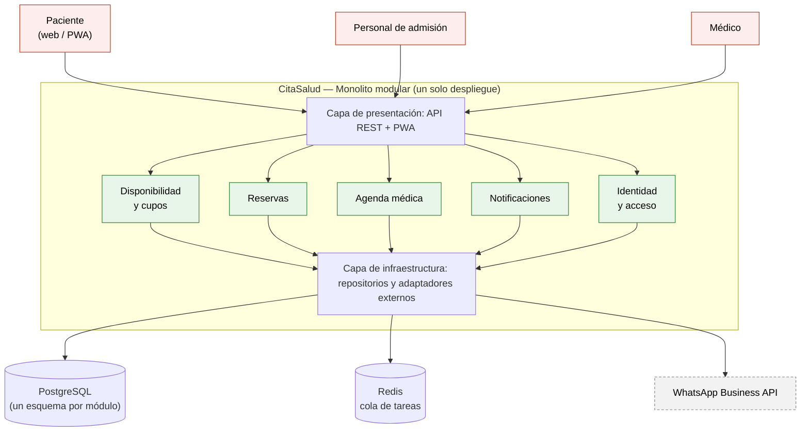

Vista de despliegue (Python Diagrams) y alternativa descartada (PlantUML):

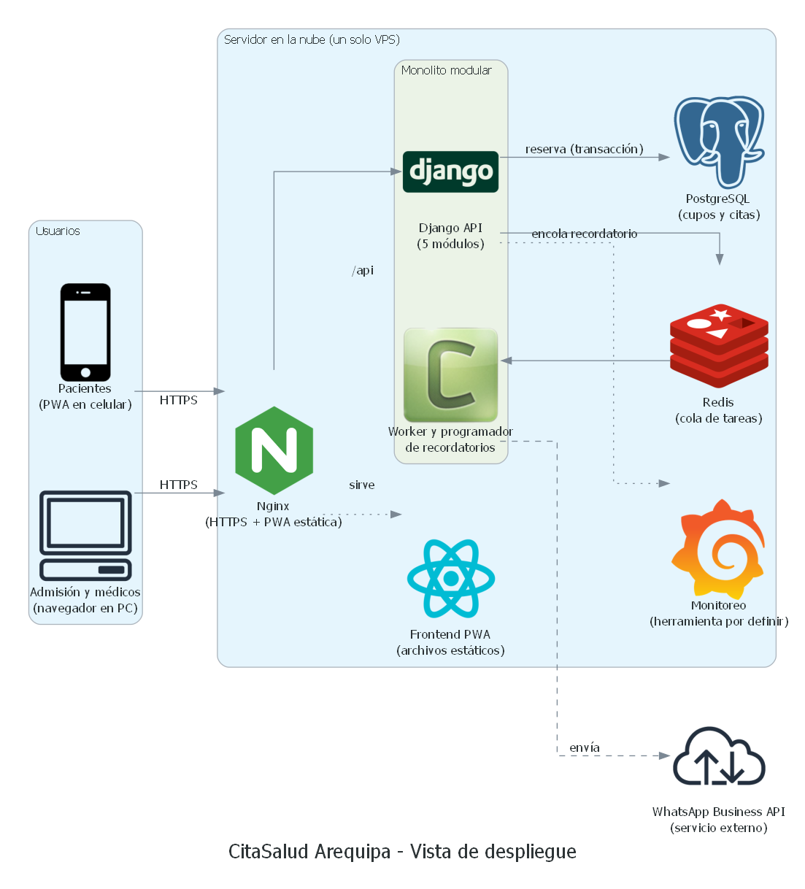
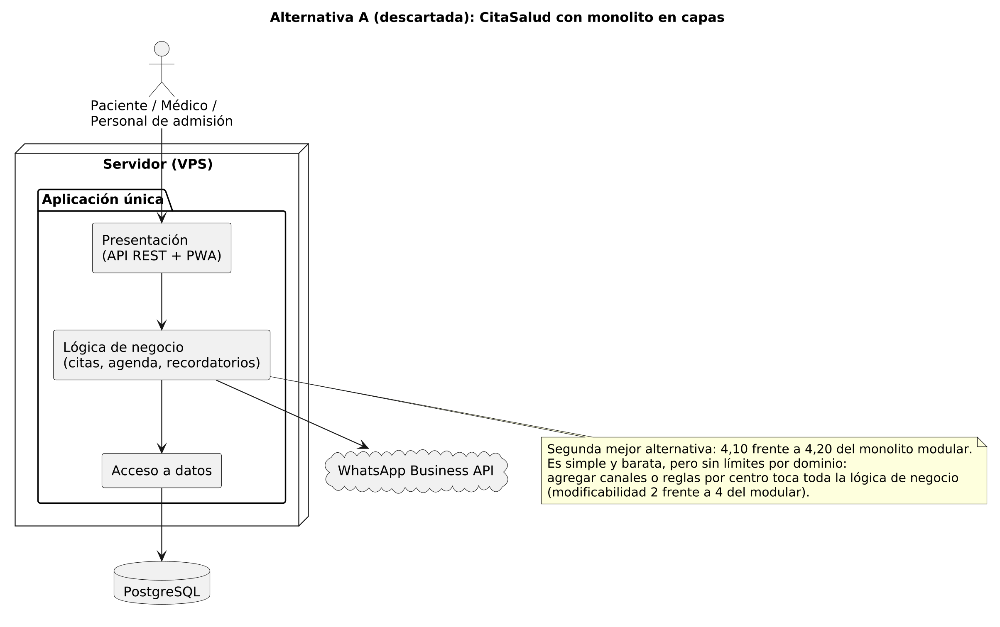

## Decisiones arquitectónicas
- [ADR-001: Estilo arquitectónico (monolito modular)](docs/architecture/adr/001-estilo-arquitectonico.md)
- [ADR-002: Reserva consistente con PostgreSQL](docs/architecture/adr/002-reserva-consistente-postgresql.md)
- [ADR-003: Recordatorios asíncronos](docs/architecture/adr/003-recordatorios-asincronos.md)
- [ADR-004: Stack tecnológico (Django y React)](docs/architecture/adr/004-stack-tecnologico.md)

## Documentación
| Entregable | Archivo |
|------------|---------|
| E1 Drivers y escenarios | [drivers.md](docs/architecture/drivers.md) |
| E2 Matriz de decisión | [matriz-decision.md](docs/architecture/matriz-decision.md) |
| E3 Diagrama Mermaid | [arquitectura.mmd](docs/architecture/diagramas/arquitectura.mmd) |
| E4 ADR | [adr/](docs/architecture/adr/) |
| E5 Alternativa descartada | [alternativa.puml](docs/architecture/diagramas/alternativa.puml) |
| E6 Vista de despliegue | [despliegue.py](docs/architecture/diagramas/despliegue.py) |
| E7 Bitácora de IA | [bitacora-ia.md](docs/architecture/bitacora-ia.md) |

Para regenerar la vista de despliegue: `pip install diagrams`, instalar Graphviz y ejecutar `python docs/architecture/diagramas/despliegue.py`.

## Reflexión sobre el uso de la IA
La IA fue una herramienta excelente para acelerar la redacción de los ADRs y estructurar la sintaxis compleja de los diagramas como código (Mermaid y PlantUML). Sin embargo, cometió errores de contexto al ignorar nuestras restricciones operativas, sugiriendo inicialmente una arquitectura de microservicios inmanejable para un equipo de 3 personas en un mes. También asumió configuraciones de infraestructura (Prometheus, Grafana) que no habíamos decidido. Aprendimos que la IA es útil para proponer y estructurar, pero las decisiones finales, los cálculos de la matriz y la validación de capacidades técnicas (como los índices parciales en bases de datos) requieren un riguroso criterio y verificación humana mediante documentación oficial.

## Diseño UML (Lab 05)

Laboratorio 05 — *UML como código* (Construcción de Software, EPIS-UNSA, 2026-B). Diseño detallado de los módulos **Reservas** y **Disponibilidad y cupos** de CitaSalud Arequipa para la historia crítica **HU-02: reservar una cita** ([historia.md](docs/design/historia.md)), coherente con el [ADR-001](docs/architecture/adr/001-estilo-arquitectonico.md) (monolito modular con puertos y adaptadores).

### Máquina de estados de la cita (Mermaid)

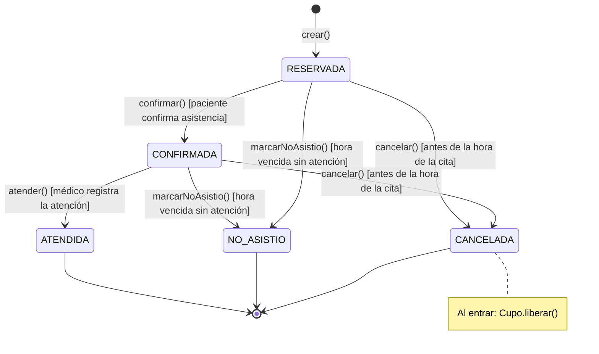

### Diagramas y entregables (Lab 05)

| Entregable | Código fuente | Imagen |
|---|---|---|
| E1 Historia y diagrama de clases | [historia.md](docs/design/historia.md), [clases.puml](docs/design/clases.puml) | 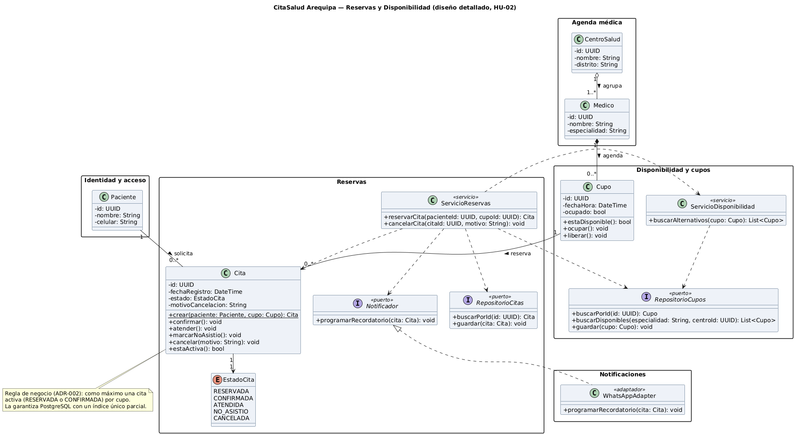 |
| E2 Diagrama de secuencia | [secuencia-reservar-cita.puml](docs/design/secuencia-reservar-cita.puml) | 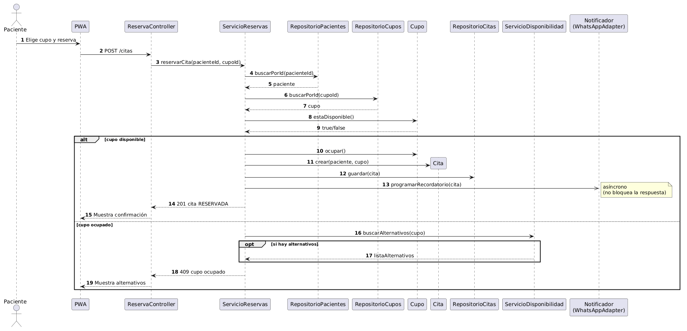 |
| E3 Máquina de estados | [estados-cita.mmd](docs/design/estados-cita.mmd) | 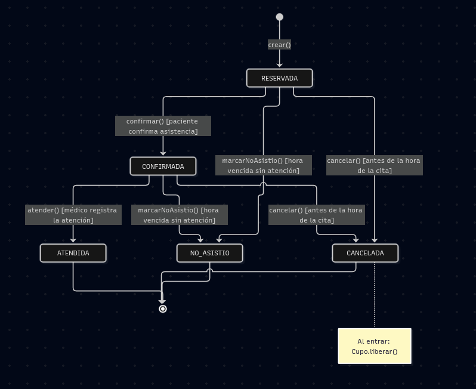 |
| E4 Diagrama de actividades | [actividades-atencion-dia.puml](docs/design/actividades-atencion-dia.puml) | 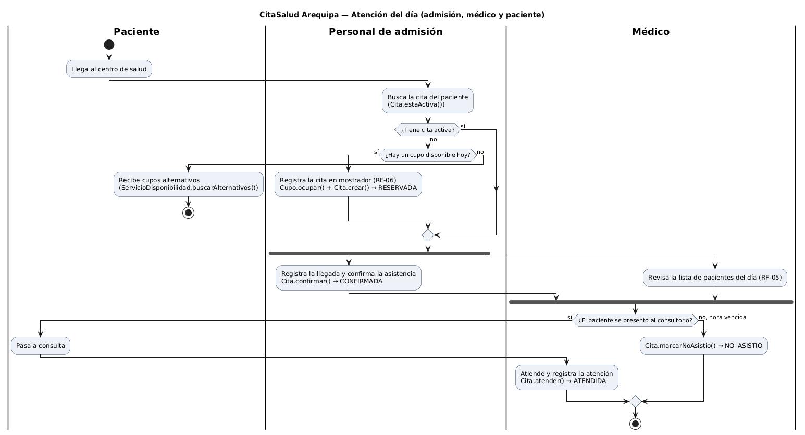 |
| E5 Diagrama de paquetes | [paquetes.puml](docs/design/paquetes.puml) | 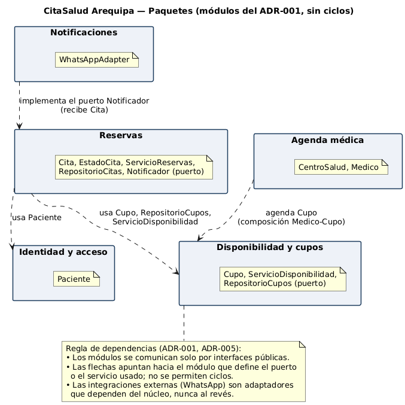 |
| E6 Round-trip | [round-trip.md](docs/design/round-trip.md), [src/reservas/](src/reservas/) | 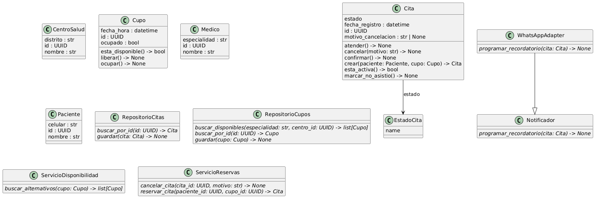 |
| E7 Consistencia y bitácora de IA | [consistencia.md](docs/design/consistencia.md), [bitacora-ia.md](docs/design/bitacora-ia.md) | — |

### Aportes del equipo (Lab 05)

| Integrante | Entregables |
|---|---|
| Estrada Arce Sergio Emilio | E1 (historia y clases), E3 (estados), ajuste del ADR-002 |
| Mamani Quispe Renzo Geomar | E2 (secuencia), E7 (consistencia y bitácora), README |
| Yana Huanca Christian Alexander | E4 (actividades), E5 (paquetes), E6 (round-trip), etiqueta de entrega |

Etiqueta de entrega: `v0.5-diseno`.

## Arquitectura C4 (Lab 06)

Modelo C4 de CitaSalud Arequipa escrito en Structurizr DSL (`docs/architecture/c4/workspace.dsl`). Todas las vistas salen de ese único archivo.

### Contexto del sistema (nivel 1)
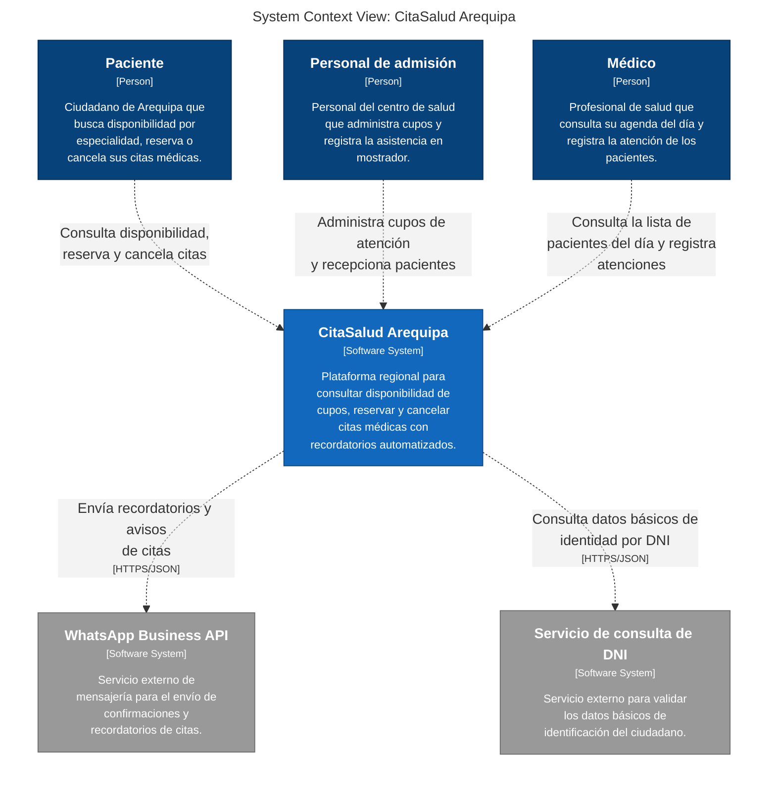

### Vistas del modelo
- [Contexto (nivel 1)](docs/architecture/c4/img/structurizr-Contexto.png)
- [Contenedores (nivel 2)](docs/architecture/c4/img/structurizr-Contenedores.png)
- [Componentes (nivel 3)](docs/architecture/c4/img/structurizr-Componentes.png)
- [Dinámica: reservar una cita](docs/architecture/c4/img/structurizr-ReservarCita.png)
- [Despliegue en producción](docs/architecture/c4/img/structurizr-Despliegue.png)

### Documentos
- [Inventario](docs/architecture/c4/inventario.md) · [Comparación](docs/architecture/c4/comparacion.md) · [Revisión con la lista oficial](docs/architecture/c4/revision-c4.md) · [Explicación para público no técnico](docs/architecture/c4/explicacion.md) · [Bitácora de IA](docs/architecture/c4/bitacora-ia.md)
- Nivel 4 (código): [clases.puml](docs/design/clases.puml) del Laboratorio 05.

Etiqueta de entrega: `v0.6-c4`.

## Patrones de diseño (Lab 07)

Refactor del flujo crítico «reservar una cita» (HU-02) hacia patrones de diseño, protegido con pruebas de caracterización y medido con radon. La decisión está en el [ADR-006](docs/architecture/adr/006-patrones-de-diseno.md) y las interacciones con IA en la [bitácora](docs/design/patrones/bitacora-ia.md).

### Olor → patrón → prueba

| Olor | Patrón | Prueba que lo demuestra |
|---|---|---|
| if/elif que elige la política de cupos alternativos | Strategy + Factory (`politicas.py`) | `test_open_closed_nueva_politica_sin_modificar_el_servicio` |
| El servicio conoce los SDK de WhatsApp y DNI | Adapter (`adaptadores.py`) | `test_observer_notifica_a_todos_los_suscriptores` (usa `WhatsAppAdapter` con un SDK espía) |
| Condicionales anidados sobre el estado de la cita | State (`estados.py`) | `test_transicion_invalida_lanza_error_por_patron_state` |
| Notificación armada a mano en el servicio | Observer (`eventos.py`) | `test_observer_nuevo_suscriptor_sin_tocar_el_publicador` |
| Bloque de reintentos duplicado | Decorator (`ConReintentos`) | `test_decorator_reintenta_solo_ante_timeout` |
| Salida del LLM no confiable | Decorator + Chain of Responsibility (`ia.py`) | `test_guardrails_bloquean_respuestas_invalidas` |

Patrón rechazado: **Singleton** para las fábricas (propuesto por la IA), por estado global y peor testabilidad.

### Métricas (radon)

| Métrica | Antes | Después |
|---|---|---|
| Complejidad de `reservar_cita()` | C (14) | A (3) |
| Complejidad promedio del módulo | B (5.4) | A (3.2) |
| Líneas de código (SLOC) | 48 | 159 |
| Archivos | 1 | 5 |

Costo: más líneas y más archivos entre los que saltar; ganancia: agregar una variante deja de modificar el servicio.

### Diagramas por patrón
[politicas](docs/design/patrones/img/politicas.png) · [estados](docs/design/patrones/img/estados.png) · [eventos](docs/design/patrones/img/eventos.png) · [ia](docs/design/patrones/img/ia.png) · [clases (actualizado)](docs/design/img/clases-reservas.png)

Etiqueta de entrega: `v0.7-patrones`.

## Diseño de la arquitectura (Lab 08)

Escenario de crecimiento: 40 establecimientos, 8 veces más reservas a las 7:00 a. m. y el servicio de DNI cae con frecuencia. Restricciones: 1 mes, un VPS, monolito modular (ADR-001).

### Árbol de utilidad
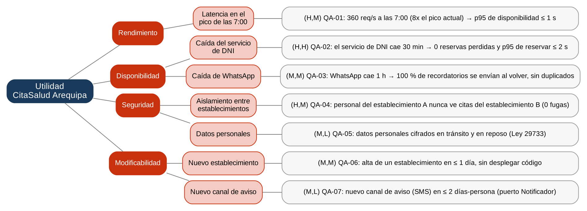

### Iteraciones de ADD
| Iteración | Escenario | Táctica elegida | Evidencia | ¿Cumple? |
|---|---|---|---|---|
| 1 | QA-01: 360 req/s a las 7:00, p95 ≤ 1 s | Caché de disponibilidad + índice | `fitness/rendimiento.py`: p95 de 33 ms (sin tácticas: 176 s) | Sí |
| 2 | QA-02: DNI caído 30 min, 0 reservas perdidas | Circuit breaker + reintentos + reserva pendiente | `fitness/disponibilidad.py`: 0 perdidas, 300 llamadas al DNI (sin tácticas: 81 000 perdidas) | Sí |
| 3 | QA-03: 0 fugas entre establecimientos | RLS en PostgreSQL | Comparación de alternativas (`add/iteracion-3.md`) | Sí |

### Decisiones y fitness functions
- ADR: [007 caché](docs/architecture/adr/007-cache-y-control-concurrencia.md) · [008 resiliencia DNI](docs/architecture/adr/008-resiliencia-servicio-dni.md) · [009 RLS](docs/architecture/adr/009-aislamiento-multi-establecimiento-rls.md)
- Iteraciones: [1](docs/architecture/add/iteracion-1.md) · [3](docs/architecture/add/iteracion-3.md)
- Fitness functions (`.importlinter`, `tests/test_fitness.py`) corren en cada Pull Request con GitHub Actions.
- Bitácora de IA: [bitacora-ia.md](docs/architecture/bitacora-ia.md)

Etiqueta de entrega: `v0.8-arquitectura`.
