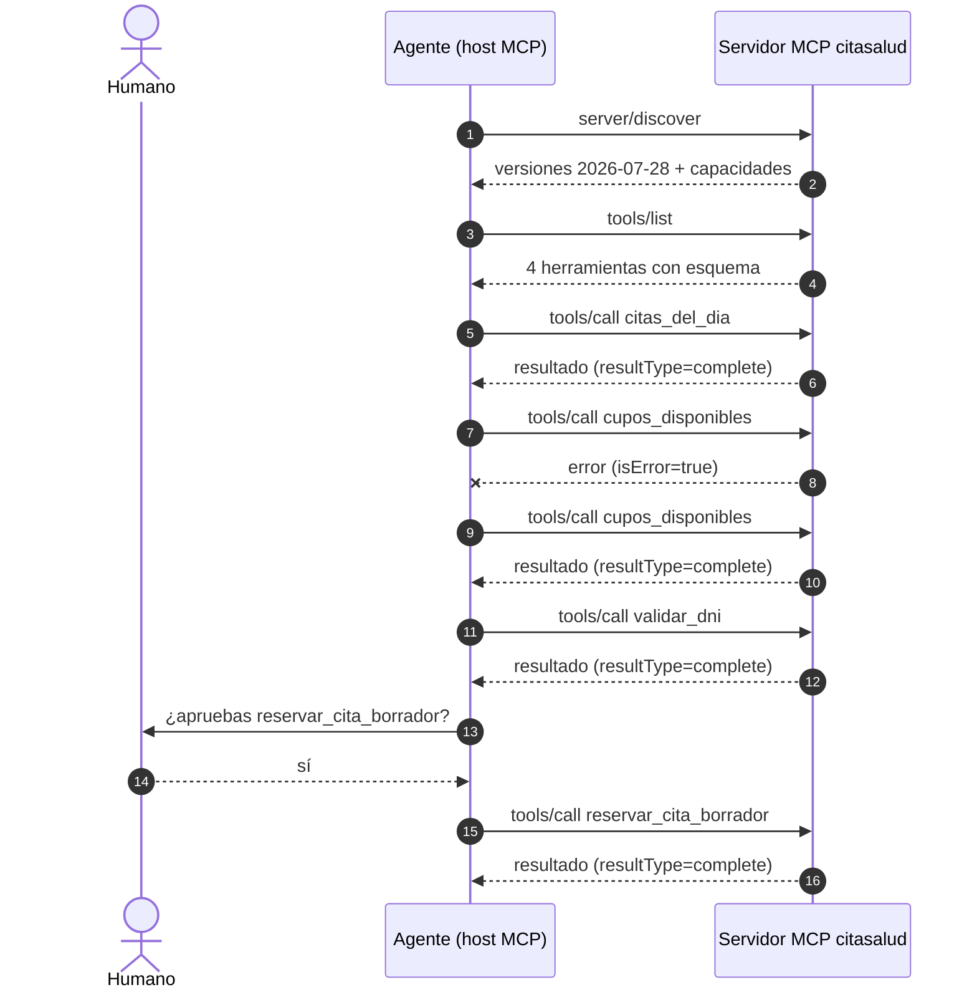

# Protocolo MCP y costo de contexto (E6)

Corrida de referencia: `consulta1` (agente del Lab 10 con `ModeloInteractivo`, servidor `citasalud` por stdio). Los datos salen de `agentes/mcp/trazas/consulta1/mcp_trafico.jsonl`, que registra el espía (`cliente/espia.py`).

## Diagrama de secuencia
Generado con `python agentes/mcp/cliente/traza_mcp.py agentes/mcp/trazas/consulta1/mcp_trafico.jsonl` (archivo `trazas/consulta1/trafico.mmd`).

Las dos flechas con el humano son la aprobación de la escritura en consola; no son mensajes JSON-RPC.

## Cómo abre la conexión
El primer mensaje es `server/discover`, no `initialize`. La especificación 2026-07-28 hizo el protocolo sin estado (guía, sección 1.5): en la traza, cada petición `tools/call` lleva en `_meta` la versión del protocolo (`2026-07-28`), el nombre del cliente y sus capacidades, y el servidor anuncia sus versiones en `server/discover`. Hasta la 2025-11-25 el host abría una sesión con `initialize` y después hacía sus peticiones. Sin sesión, cualquier instancia del servidor podría atender cualquier petición.

## Métricas (salida real de `metricas`)
| Medida | Valor |
|---|---|
| Mensajes | 14 (7 peticiones y 7 respuestas: `server/discover`, `tools/list` y 5 `tools/call`) |
| Errores | 1 (un resultado con `isError`, la llamada a `cupos_disponibles` sin `especialidad`) |
| Bytes | 7 201 |
| `server/discover` | 2 129,5 ms |
| `tools/list` | 3,1 ms |
| `tools/call` (5 llamadas) | 15,2 · 48,0 · 4,3 · 5,4 · 8,9 ms |

- La latencia de `server/discover` incluye el arranque del proceso del servidor; no es el costo del protocolo.
- La respuesta de `tools/list` pesa 2 679 bytes, el 37,2 % del tráfico: el catálogo viaja completo en cada conexión y el modelo lo lee en cada turno.
- El error fue de negocio (`isError: true`), no un error de JSON-RPC: el agente lo leyó y repitió la llamada con `especialidad` (paso 4 de la trayectoria).
- El paso 2 de la trayectoria (`CONTRATO_INVALIDO`, una línea pegada por error) ocurrió en el agente y no aparece en el tráfico: el contrato lo rechazó antes de llamar al servidor.

## Costo de contexto del catálogo
Medido con `python agentes/mcp/cliente/costo_catalogo.py` (nombre, descripción y esquemas de cada herramienta; 1 token ≈ 4 caracteres).

| Herramienta | Antes (caracteres) | Después (caracteres) |
|---|---:|---:|
| `cupos_disponibles` | 567 | 554 |
| `citas_del_dia` | 535 | 529 |
| `validar_dni` | 439 | 427 |
| `reservar_cita_borrador` | 468 | 465 |
| **Total** | **2 009 (≈ 502 tokens)** | **1 975 (≈ 493 tokens)** |

### Optimización aplicada
Se acortaron las cuatro descripciones sin cambiar nombres, parámetros, formatos ni valores válidos. Por ejemplo, `validar_dni` pasó de «Valida un DNI sintético de ocho dígitos ASCII con prefijo 999 mediante el adaptador simulado.» a «Valida un DNI sintético (8 dígitos ASCII, prefijo 999) con el adaptador simulado.». Resultado: 34 caracteres menos (−1,7 %, unos 9 tokens por turno).

La reducción es pequeña porque el catálogo ya era compacto: las descripciones son menos de la cuarta parte del costo y el resto son los esquemas de entrada y salida.

### Lo que se evaluó y no se aplicó
- **Quitar los `title`** (121 caracteres): lo descartamos porque el host los muestra al usuario («Consultar agenda del día», «Crear borrador de cita») y aparecen en la evidencia de `uso-en-host.md`.
- **Fusionar `validar_dni` en `reservar_cita_borrador`:** habría bajado el catálogo de 1 975 a 1 548 caracteres (−427 caracteres, −21,6 %, unos 106 tokens). Lo descartamos porque `validar_dni` se usa sola en las evidencias de E4 y E5, tiene cinco pruebas y la escritura ya valida el DNI por dentro. Quedaría una consulta de validación menos para el modelo.

### ¿Siguió el agente eligiendo bien?
Se repitió la trayectoria grabada de `consulta1` con el catálogo acortado (`consulta2`, `--modelo grabado`): mismos 6 pasos, mismas herramientas, 14 mensajes y 7 172 bytes (−29 bytes respecto de 7 201). Eso confirma que nombres y argumentos siguen siendo compatibles. No mide si un asistente elige igual con las descripciones nuevas, porque las decisiones vienen grabadas.
