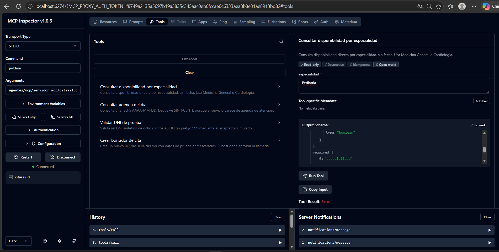
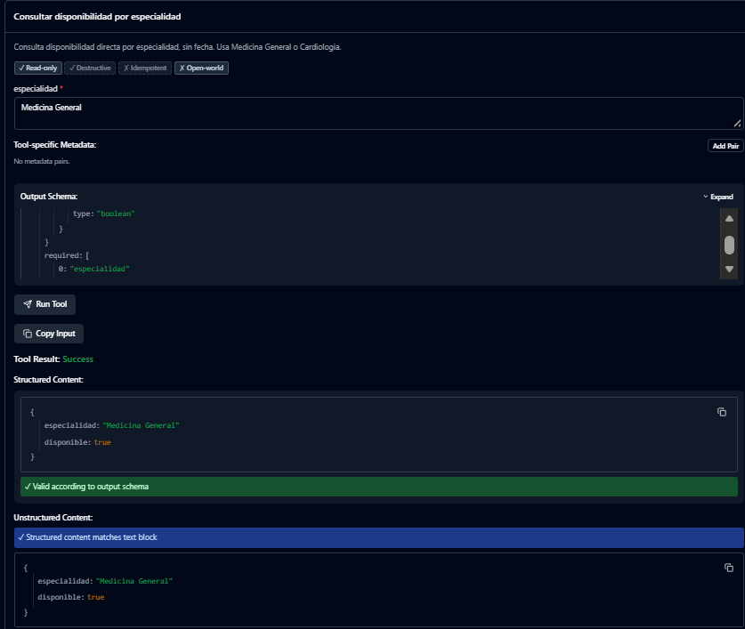
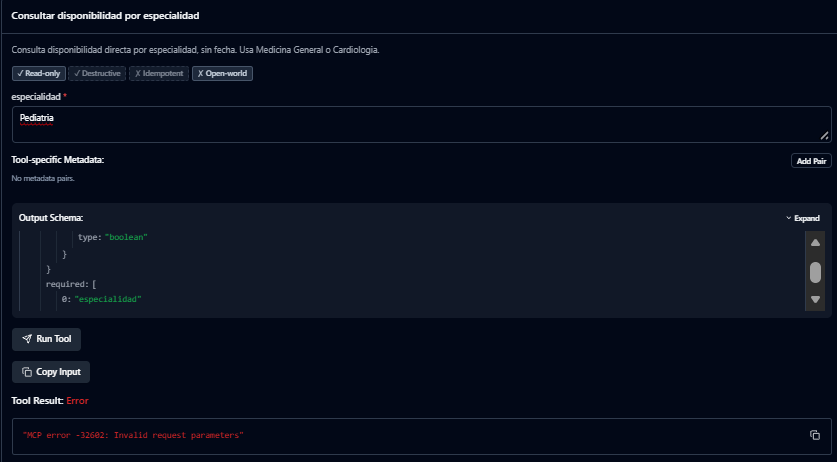

# Evidencia con MCP Inspector (E3)

Herramienta: MCP Inspector v1.0.6, transporte STDIO, comando
`python agentes/mcp/servidor_mcp/citasalud_mcp.py`.

## Captura 1: catálogo (Figura 6)

Inspector se conectó por STDIO y listó las 4 herramientas de CitaSalud con título
y descripción. Para `cupos_disponibles` muestra la anotación Read-only, el
parámetro obligatorio `especialidad` y su esquema de salida. El historial registra
`initialize` y `tools/list`.

## Captura 2: llamada correcta (Figura 7a)

`cupos_disponibles` con `Medicina General` devuelve éxito y contenido estructurado
`{"especialidad": "Medicina General", "disponible": true}`. Inspector confirma que
es válido según el esquema de salida y que coincide con el bloque de texto.

## Captura 3: llamada con error (Figura 7b)

Con `Pediatria` el resultado llega marcado como Error y el mensaje indica los
valores válidos (`Medicina General, Cardiologia`). Es un error de la herramienta
visible para el modelo, así que un agente puede leerlo y reintentar.

## Nota
No se ejecutó `reservar_cita_borrador` en Inspector para no crear borradores
innecesarios; la escritura se evidencia en E4 (con aprobación) y en E5.