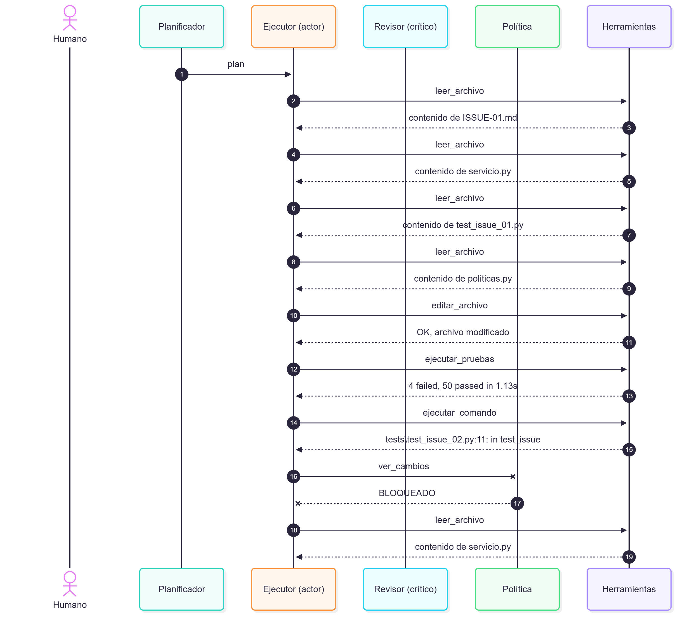

# Observación de las trazas (E7)

Métricas de los tres issues, calculadas con las trazas JSONL de `agentes/trazas/` (pasos, herramientas y bloqueos) y con el contexto que imprime cada runner. «Pasos» son las acciones del agente sin contar la respuesta final.

| Issue | Corrida | Pasos y rondas | Herramientas usadas | Rechazadas por el contrato | Bloqueadas | Contexto final |
|---|---|---|---|---:|---:|---:|
| 1 | `issue1_unico` (E2) | 9 pasos, 1 ronda | `leer_archivo` ×5, `editar_archivo`, `ejecutar_pruebas`, `ejecutar_comando`, `ver_cambios` | 0 | 1 (`ver_cambios`, por la política) | 17 675 caracteres |
| 2 | `issue2_unico` (E5) | 5 pasos, 1 ronda | `ejecutar_pruebas` ×2, `leer_archivo` ×2, `editar_archivo` | 0 | 0 | 4 381 caracteres |
| 2 | `issue2_actor_critico` (E5) | 6 pasos (ejecutor 4, revisor 2), 1 ronda | `ejecutar_pruebas` ×3, `leer_archivo`, `editar_archivo`, `ver_cambios` | 0 | 0 | 7 613 caracteres entre tres agentes |
| 3 | `issue3_notas` (E4) | 9 pasos, 1 ronda | `ejecutar_pruebas` ×3, `editar_archivo` ×2, `mapa_repo`, `anotar`, `leer_notas`, `leer_archivo` | 0 | 0 | 16 164 caracteres |

Diagrama de la trayectoria del issue 1 (generado con `python agentes/agente/traza.py agentes/trazas/issue1_unico`):

## Lectura

- **Los tres issues se resolvieron** y la suite quedó en verde (74 pruebas al cerrar E5). Ningún ejecutor editó `tests/`.
- **El contrato no rechazó ninguna decisión** en las corridas registradas. Las únicas respuestas inválidas (comillas tipográficas) se detectaron antes de pegarlas en la consola, así que no aparecen en las trazas; están en `bitacora-ia.md`.
- **El contexto depende del issue más que de la técnica:** el issue 1 (leer cuatro archivos) llegó a 17 675 caracteres; el issue 2 con agente único, a 4 381. Por eso no comparamos E2 con E4 como si fueran el mismo problema.
- **Lo que falta del humano:** el humano pegó cada decisión, aprobó el diff y aplicó el cambio. En ninguna corrida se probó un asistente conectado por API ni inyección indirecta (queda para el Laboratorio 13).

## E6: repetición con aprobación humana

Se repitió la trayectoria grabada del issue 1 sobre el commit `44a5e8b` (las cinco pruebas en rojo) con `--modelo grabado --aprobar`. Con «s» la edición pasa: 9 pasos, 1 bloqueo (`ver_cambios`). Con «n» la política bloquea la edición del paso 5 (`El revisor humano rechazó la edición`): 9 pasos, 2 bloqueos. Es una repetición de decisiones ya grabadas, no una corrida nueva con el asistente. Trazas en `trazas/issue1_aprobacion/` y `trazas/issue1_rechazo/`.

## Detalle de las corridas de E4 y E5

Las decisiones se registraron con `ModeloInteractivo`; cada herramienta operó sobre
`agentes/trabajo/`, una copia nueva por corrida. El cambio aplicado a `src/` se
revisó con `git diff --no-index` antes de copiarlo. Ningún ejecutor editó `tests/`.

| Corrida | Rondas | Acciones permitidas | Bloqueadas | Contrato inválido | Contexto final |
| --- | ---: | ---: | ---: | ---: | ---: |
| E2, issue 1, único (referencia de Christian) | 1 | 8 | 1 | 0 | 17 675 caracteres |
| E4, issue 3, único con mapa y notas | 1 | 9 | 0 | 0 | 16 164 caracteres |
| E5, issue 2, único | 1 | 5 | 0 | 0 | 4 381 caracteres |
| E5, issue 2, actor–crítico | 1 | 6 | 0 | 0 | 7 613 caracteres entre tres agentes |

El contexto E2 y E4 es el recuento de `str(historial)` impreso por el runner;
el de E5 usa `json.dumps(historial, ensure_ascii=False)` para comparar las dos
variantes con la misma medida. En E5 el actor–crítico se descompone en
planificador (935), ejecutor (4 953) y revisor (1 725) caracteres. La memoria
de E4 guardó una nota de 109 bytes dentro del sandbox y se recuperó una vez.
E4 no redujo los pasos frente a E2 (9 frente a 9); el contexto fue 1 511
caracteres menor, pero son issues distintos, por lo que no se puede atribuir
esa diferencia a las notas. La primera edición del issue 3 causó una regresión
en una cita simulada sin atributo `estado`; las pruebas la detectaron y el
agente la corrigió en una segunda edición.

## Comparación de coordinación para el issue 2

El agente único modificó `ReniecSDK.consultar` con `dni.isdigit()` y dejó las
54 pruebas de la copia en verde. El planificador del actor–crítico pidió revisar
también los dígitos Unicode; el ejecutor validó ocho dígitos ASCII en
`DniAdapter` y el revisor comprobó el diff y la suite. Aprobó en la primera
ronda y no pidió cambios. Una prueba de regresión añadida por el humano confirma
la diferencia: `"１２３４５６７８".isdigit()` es verdadero y esa entrada debe rechazarse.
Con el cambio aprobado aplicado al repositorio, `pytest -q` da 74 aprobadas
(incluida una prueba adicional de la política).

El bucle actor–crítico agregó una acción (6 frente a 5) y 3 232 caracteres de
contexto (7 613 frente a 4 381). En esta corrida, el planificador identificó
un caso que la variante única pasó por alto, pero el revisor no encontró un
defecto adicional ni fue necesaria una segunda ronda. Para un error tan
acotado, el costo de tres agentes no se justifica de forma general: conviene
empezar con uno y agregar revisión independiente cuando el riesgo o la
complejidad del cambio lo requieran (principio de parsimonia).

## Interacciones registradas para la bitácora de E7

| Corrida y paso | Decisión u observación | Efecto |
| --- | --- | --- |
| E4, paso 1 | `ejecutar_pruebas` encontró cuatro fallos | Se reprodujo el issue 3 antes de editar. |
| E4, pasos 2–4 | `mapa_repo`, `anotar` y `leer_archivo` ubicaron el suscriptor | La nota quedó en `trazas/issue3_notas/notas.md`. |
| E4, pasos 6–8 | Las pruebas detectaron `AttributeError` tras la primera edición | El ejecutor corrigió el acceso a `estado` y repitió pytest. |
| E5 único, paso 4 | `editar_archivo` añadió `isdigit()` al SDK | Las pruebas existentes pasaron, pero quedó el caso Unicode. |
| E5 actor–crítico, plan | El planificador incluyó los dígitos Unicode | El ejecutor aplicó validación ASCII en el adaptador. |
| E5 actor–crítico, revisor | `ver_cambios` y `ejecutar_pruebas` verificaron el cambio | Primera ronda aprobada; cero acciones bloqueadas. |

Trazas y diagramas: `trazas/issue3_notas/`, `trazas/issue2_unico/` y
`trazas/issue2_actor_critico/`. Las decisiones completas están en
`trayectorias/` con las mismas etiquetas.
